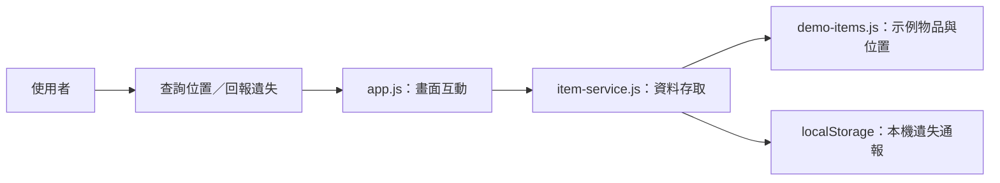
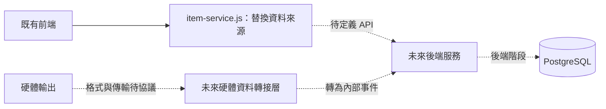

# 前端架構與串接邊界

本版範圍是查詢物品最後位置及回報遺失。頁面與資料存取分開，先用示例資料驗收兩個流程，之後再接真正的後端服務。

## 目前資料流程

Node.js 的 `scripts/serve.mjs` 只提供靜態檔案，讓瀏覽器能正常載入 ES module；它不是 RFID 接收服務，也不提供應用程式 API。

## 分層

| 層次 | 檔案 | 職責 |
| --- | --- | --- |
| 頁面 | `public/index.html` | 查詢與通報兩個操作區域、物品資訊、操作結果 |
| 樣式 | `public/css/style.css` | 桌面與行動裝置版面 |
| 互動 | `public/js/app.js` | 搜尋、選取、表單檢查、顯示結果；不解析硬體資料 |
| 資料存取 | `public/js/services/item-service.js` | 統一非同步呼叫介面，整合示例資料與本機通報 |
| 示例資料 | `public/js/data/demo-items.js` | 四筆物品與示例最後感應資訊；雨傘沒有感應紀錄 |

資料存取層提供 `listItems`、`searchItems`、`getItem` 與 `reportLost({ itemId, description })`。畫面只呼叫這些方法，因此未來可以把資料來源改成後端，而不必讓畫面直接處理硬體封包。

## 遺失通報的保存與重複處理

通報以物品識別值對應 localStorage 中的本機紀錄；同一物品重複提交時沿用既有通報，物品狀態顯示為遺失。這是避免重複建立前端通報的處理。

目前沒有 RFID 讀取事件、閘門 buffer 或讀取去重服務。RF 反覆讀取、同一封包重送及跨閘門事件的判斷，應等後端階段共同定義，再以資料庫與事件處理流程實作。

localStorage 的通報只屬於同一網址的同一瀏覽器，沒有登入帳號、跨裝置同步或伺服器備份；位置資料仍維持示例值，不因通報而產生新的感應位置。

## 未來接後端的位置

虛線部分是未來工作，尚未建立。建議後續依序確認：

1. **前後端資料需求**：物品識別、名稱、遺失狀態，以及最後感應位置與時間的表示方式。
2. **後端 API**：查詢物品、查詢最後位置與提交遺失通報所需的操作、錯誤格式及回應內容。路徑尚未決定，本版不預先宣稱任何接口已可接收資料。
3. **硬體協議**：RFID 原始 JSON、訊息識別值、時間來源、閘門識別、傳輸方式、接收地址、確認與重送方式。
4. **事件與資料庫**：硬體轉接層將已協議的封包映射成內部事件；後端再處理讀取去重、位置更新與 PostgreSQL 儲存。

只有在協議確定後，才實作對應的硬體轉接層與接收接口。前端應持續使用物品資料服務，不直接綁定廠商或組員的原始 JSON 格式。
