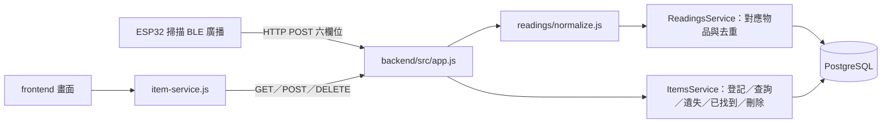

# 前後端架構

專案分成 `frontend/`、`backend/` 與共用 `scripts/`、`docs/`。所有 npm 指令從根目錄執行；`npm start` 同時提供瀏覽器頁面與 API。

## 檔案分工

| 位置 | 職責 |
| --- | --- |
| `frontend/public/index.html`、`css/style.css` | 登記、查詢與回報頁面，樣式與響應式排版 |
| `frontend/public/js/app.js` | 登記、搜尋、位置／訊號顯示、遺失／已找到，以及刪除確認與取消 |
| `frontend/public/js/services/item-service.js` | API 存取與回應驗證；提供 `createItem`、`listItems`、`searchItems`、`getItem`、`reportLost`、`markFound`、`deleteItem` |
| `frontend/public/js/config.js` | API 根網址；預設沿用頁面主機名稱的 3000 埠 |
| `backend/src/server.js` | 讀取 `backend/.env`、執行升級、啟動 HTTP 服務 |
| `backend/src/app.js` | API 路由、JSON 限制、錯誤回應及前端靜態檔案 |
| `backend/src/readings/normalize.js` | 驗證六欄位、統一 MAC、加入伺服器接收時間 |
| `backend/src/services/item-mapping.js` | 依 MAC 查詢有效綁定；未登記或已刪除時不自動建立／恢復物品 |
| `backend/src/services/readings.js` | 事件重送去重、連讀合併、閘門與位置紀錄更新 |
| `backend/src/services/items.js` | 物品登記／再登記、查詢、遺失／已找到及物品軟刪除 |
| `backend/src/db/` | `pg` 連線池、交易、資料表、升級與種子登記 |
| `backend/scripts/serve.mjs` | 提供 `frontend/public/` 靜態檔案；也可單獨啟動前端服務 |
| `scripts/check.mjs` | 全專案靜態檢查 |

## 讀取、位置與去重

ESP32 透過 HTTP 傳送 `gate_id`、`location`、`item_name`、`ble_id`、`rssi`、`timestamp`。轉換層清除文字前後空白、將 MAC 統一小寫並驗證型別，另加伺服器 `received_at`。ESP32 的 timestamp 是開機毫秒，不轉成日期，也不當成事件 ID。

物品對應以 MAC 為準，不以廣播名稱判定身分。未登記 MAC 的事件只建立未綁定標籤並存入 `gates_event`，回應 `item_id: null`，不會新增物品清單項目。已登記物品保留原有名稱、ID 與通報。感應當下的廣播名稱、位置與訊號另存於 `gates_event`，不覆寫使用者名稱。
物品若已刪除，後續新上報仍保留事件 metadata，但回 `item_id: null`，不自動恢復。事件重送仍回原快照，因此可能帶有原物品 ID；這不改變物品已刪除的狀態。

同 MAC 的最新事件若閘門、位置相同，且距最後有效接收小於預設 3 秒，更新原事件的接收時間、RSSI、開機毫秒與讀取次數。閘門／位置改變或達到時間窗時建立新紀錄；前端的最後位置由該 MAC 最新事件查出。

可選的 `Idempotency-Key` 依閘門與識別碼持久化去重。重送同一內容時回原始回應快照，不增加次數、不延長時間、不更新位置；同識別碼卻改內容會拒絕。未提供識別碼時只能合併連讀，無法可靠辨識網路重送。事件鎖、MAC 鎖與資料寫入均在同一筆交易中處理。

畫面顯示物品、位置、閘門、MAC、RSSI 與以 `received_at` 轉換的台灣時間。後端接收 HTTP JSON，並非瀏覽器直接連接 BLE；實體 ESP32 燒錄與現場連線仍須另外驗證。

## 登記與查詢流程

1. 使用者在「登記物品」填自行命名的 `item_name` 與 `ble_id`；`createItem` 呼叫 `POST /api/items`。
2. 後端建立物品並綁定 MAC，成功回 201。MAC 已綁定有效物品時回 409；若綁定的是已刪除物品，這次明確登記會以輸入名稱恢復原 ID，同樣回 201。不同 MAC 的名稱可以相同。
3. 前端重新 GET 清單並選取新物品。之後依登記名稱搜尋，由候選結果選取物品，以 MAC 區分同名項目，再查最後位置。
4. 若該 MAC 在登記前已有感應事件，`tag.item_id` 綁定後即可透過既有 MAC 查出歷史最後位置；不會重建或刪除感應紀錄。

已有登記資料繼續沿用，不因升級強制改名或清空資料。再次登記已刪除 MAC 是明確恢復動作，與硬體上報或執行種子資料不同。

## 遺失與已找到

回報遺失時，`ItemsService.report` 沿用同物品尚未結案的通報。物品明細只在 `status === "lost"` 時顯示「已找到」；`markFound(id)` 送出 `POST /api/items/:id/found` 與 `{}`。

`ItemsService.found` 把有效通報的 `deleted_at` 設為結案時間，不刪除物品、通報或位置。查詢狀態只考慮 `deleted_at IS NULL`，因此結案後物品恢復 `normal`，離開遺失清單。前端會重新查詢清單與明細；若寫入成功但重新查詢失敗，分別提示儲存結果與更新失敗。

重複結案不改寫時間；沒有通報的物品回 `already_found: true` 與 `resolved_at: null`。同物品日後再遺失可新增通報，先前紀錄繼續保留。資料列鎖與部分唯一索引確保每件物品最多一筆有效通報。

## 刪除物品登記

物品明細提供「刪除物品」，按下後在明細內顯示確認與取消。確認才呼叫無 body 的 `DELETE /api/items/:id`；取消不送出請求。成功後立即從畫面移除該物品，再更新資料；若重新查詢失敗，清楚區分刪除已成功與畫面更新失敗。

後端將 `items.deleted_at` 設為刪除時間，並以同一時間結束有效通報，不實體刪除資料。重複刪除回同一時間與 `already_deleted: true`。查詢、搜尋與遺失篩選排除已刪除物品，單件查詢、遺失回報與已找到則回 404。

「已找到」只結束通報、物品仍在清單；「刪除物品」隱藏物品登記。兩者各自保留原資料。沒有垃圾桶或獨立還原頁面；需要使用已刪除 MAC 時，透過原本「登記物品」流程恢復原 ID 與歷史。

資料庫升級在交易內執行，保留舊資料與識別值，未知 RSSI／開機毫秒為 null。表與關聯見 [database.md](database.md)，完整接口見 [api.md](api.md)。
